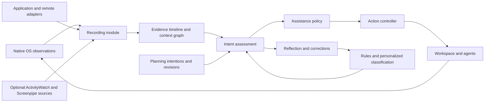

# Advanced DeepBlock vision and implementation direction

**Status: agreed product direction with proposed advanced implementation phases.** The Rust/Tauri runtime implements planning, review, manual project/goal context, intent history, SQLite storage, and portable recovery. First-party production recording, automatic project discovery/context enrichment, inferred intent assessment, and workspace assistance remain future capabilities. The delivered foundation is summarized in [Completed planning foundations](pre-advanced-roadmap.md#completed-work).

**Decision date: 2026-10-07.** Preserve this direction as the basis for implementation proposals; record changes to settled decisions explicitly. Upstream capabilities and licenses must be checked against the exact versions selected for implementation.

**Roadmap refinement: 2026-10-08.** The [completed foundations](pre-advanced-roadmap.md) include SQLite design, migration, portable recovery, and the related UI workflows. Production recording, assessment, and assistance remain future work.

**Product refinement: 2026-10-09.** The [mindful self-direction principles](mindful-self-direction.md) govern this architecture and its acceptance criteria. The daily experience starts with a notebook-like plan, ordinary revisions, notes, and voluntary reflection. Technology supplies optional evidence and assistance while preserving the user's judgment.

DeepBlock will help people choose an intention, understand how their computer activity relates to it, and shape their working environment to support it. Ship this as one local-first product, with orthogonal planning, recording, assessment, and assistance modules behind well-defined APIs. The recording module supplies evidence independently of planning; DeepBlock retains ownership of intentions, plan revisions, reflection, and assistance preferences. ActivityWatch, Screenpipe, application plugins, and remote agents can contribute additional evidence through optional adapters.

The product should provide the kind of useful feedback a smartwatch provides about sleep: an understandable account of patterns, uncertainty, and opportunities to improve. Foreground activity, context continuity, and goal alignment are observable or estimable signals. Cognitive depth, meaningful attention, and completed work require additional evidence and user judgment.

## Product goals

The long-term goal is a computer environment that supports mindful self-direction, with enough evidence for self-assurance and honest reflection. Goals and commitments help describe chosen intentions; users may revise them, rest, explore, or choose a different direction. The system should:

- Keep ordinary planning brief, revisions deliberate, and notes and possible work within one coherent experience.
- Make observation useful without requiring constant tracking review, goal metadata, or AI interaction.
- Describe unscheduled digital activity neutrally; assess alignment only against an applicable user-chosen intention.
- Account for foreground application and window time, while separately describing interaction, visibility, idle state, and collection gaps.
- Identify the actual project inside an application, including personal work and work for multiple employers or clients.
- Follow nested terminal and development contexts across kitty, SSH, tmux, Neovim, VS Code, local repositories, and remote machines.
- Relate coding, documentation, research, communication, and AI conversations to a shared task or work episode.
- Explain detours, unrelated project switching, sustained continuity, and returns to a chosen goal.
- Let users correct classifications and teach the system their projects, definitions, and recurring workflows.
- Provide useful local operation without ActivityWatch, Screenpipe, a hosted model, or a continuously available GPU server.
- Offer one installation and coherent settings, with recording and assistance optional and planning usable independently.
- Support optional local models, self-hosted inference, and hosted decision or language models without transferring ownership of the clock or evidence to them.
- Let compatible processing stages move between local and external providers without changing the planning, recording, or assessment contracts.
- Offer user-selected assistance ranging from retrospective reflection to notifications, brief visual cues, reversible workspace changes, and agent-prepared working environments.
- Eventually support voice commands and research agents that prepare relevant sources and windows for human consumption.
- Eventually reconcile activity across computers and mobile devices, including distraction on a phone while a work window remains open on a computer.

The ambition allows sustained research and development, potentially over several years. Delivery should proceed through demonstrable capabilities rather than waiting for universal coverage.

## Decisions and boundaries

| Area               | Agreed direction                                                                                           | Implementation still to resolve                                  |
| ------------------ | ---------------------------------------------------------------------------------------------------------- | ---------------------------------------------------------------- |
| Product packaging  | One DeepBlock product with optional, orthogonal recording, assessment, and assistance                      | Helper packaging, supervision, and explicit background lifecycle |
| Module ownership   | Planning owns intentions; recording owns observations; assessment and actions have separate contracts      | Versioned APIs, transports, and fault isolation                  |
| Independence       | Ship first-party recording and a useful offline baseline                                                   | Exact libraries and collector implementation                     |
| Structured storage | Keep canonical SQLite for planning before advanced recording; retain Markdown notes and TOML configuration | Acceptance evidence and supported native upgrade validation      |
| ActivityWatch      | Preserve as optional interoperability and a source of architectural ideas                                  | Import, live watcher compatibility, and selective library reuse  |
| Screenpipe         | Use as an architectural reference and optional evidence source                                             | Whether an adapter delivers enough value to maintain             |
| Time accounting    | Derive foreground intervals from observed state transitions                                                | Native collectors, reconciliation, and precision targets         |
| Project context    | Use stable identities and relationships between currently presented contexts                               | Protocol schema and adapter implementations                      |
| AI                 | Use replaceable local and external processors for bounded tasks                                            | Capability matching, models, training, latency, and calibration  |
| Desktop UI         | Preserve Rust/Tauri and the shared React interface                                                         | Swift helper versus an in-process native bridge                  |
| Assistance         | Apply explicit user preferences through a separate controller                                              | Policies, thresholds, supported actions, and UX                  |
| Expansion          | Design for multiple devices and future voice or agent workflows                                            | Platform coverage, synchronization, and mobile permissions       |

Self-sufficiency means users can install and use the core without another product running. Reusing well-scoped open-source libraries remains compatible with that goal. Users should not have to install a recorder product, administer a scraping backend, or assemble several dashboards for the ordinary experience. Browser extensions and remote agents remain guided, optional additions where deeper context requires them.

DeepBlock must work with recording disabled. Recording must be testable and consumable through its API without the planner as a consumer. A separately distributed recorder remains a possible future use of that boundary; it is not the default product or an initial delivery requirement.

## Relationship to the current repository

The foundation is already useful: daily plan revisions, recoverable notes, a backlog, voluntary outcomes, comparison, review, a Rust Axum server, a Rust CLI, and a shared browser/Tauri UI. ActivityWatch currently provides optional local enrichment for on-demand audits. Desktop reminders are time-based. Real-time interventions have no production event source yet. See [Configuration](../configuration.md), [Core planning trust](../features/core-planning-trust.md), and [Feature gaps](feature-gap-analysis.md).

Preserve the current save contracts: notes autosave, UI scheduling changes explicitly commit a revision, and outcomes annotate feedback independently. Sensor observations must not silently revise plans, assert completion, or replace self-reported focus and duration. A voice command that changes scheduling must use the same deliberate planning contract.

Existing ActivityWatch `focus_score` values describe category mix. They are unsuitable as direct authority for future workspace control. Add richer assessments with their own evidence and coverage rather than silently changing the meaning of historical fields. See [the current audit implementation](../../apps/server/src/aw.rs).

Plan revisions and annotations do not make every current planning field immutable. An assessment must retain a timestamped intent snapshot or stable version reference sufficient to reconstruct the intention effective at the time, including under revision strategies with a mutable active head.

## System architecture



Four responsibilities should remain independently testable:

| Component           | Owns                                                                                          | Produces                                                            |
| ------------------- | --------------------------------------------------------------------------------------------- | ------------------------------------------------------------------- |
| Observation runtime | Collection, source health, normalized events, context relationships, and evidence retention   | Timelines and current context with explicit gaps                    |
| Planning and intent | Goals, commitments, schedules, plan revisions, voluntary outcomes, and assistance preferences | Intent snapshots and reflection workflows                           |
| Assessment engine   | Versioned attribution and interpretation using rules, models, and corrections                 | Project attribution, goal alignment, work episodes, and uncertainty |
| Action controller   | Policy evaluation, supported desktop actions, action records, and reversal                    | Notifications, workspace changes, and bounded agent actions         |

These boundaries do not require four services or a new repository. Start with focused Rust modules and a narrow macOS integration. Package supervised native or model workers where permissions, crash isolation, or workload justify separate processes. One installer, launcher, update flow, and settings surface owns their lifecycle; the user need not administer those processes.

Keep the user-facing surfaces orthogonal as well: planning and voluntary reflection, recorded evidence, inferred assessments, and assistance controls have distinct states and permissions. Opening the planner must not require capture permission or a loaded model. Disabling assessment or assistance must not disable ordinary planning. Closing the UI may leave an explicitly enabled tray/background mode running; quitting and any continued recording behavior must be clear and configurable.

### Module API contracts

The following are proposed responsibilities, not implemented endpoints. Publish versioned schemas and contract fixtures before selecting HTTP, local IPC, or in-process transports. Consumers use APIs rather than reading another module's tables or calling its private internals.

| Boundary         | Operations and outputs                                                                                                 | Authority limit                                                                              |
| ---------------- | ---------------------------------------------------------------------------------------------------------------------- | -------------------------------------------------------------------------------------------- |
| Planning         | Existing deliberate plan/outcome operations; read or subscribe to effective intent snapshots                           | Sensors and processors cannot silently write plans or claim completion                       |
| Recording        | Submit observations; query or subscribe to context, intervals, coverage, and source health; manage pause and retention | Owns observed facts and timing, not inferred intent alignment                                |
| Processing       | Discover capabilities; submit, cancel, and inspect typed OCR, classification, embedding, or vision jobs                | Produces derived evidence; cannot own the clock or execute desktop actions                   |
| Assessment       | Read or subscribe to versioned attribution/alignment; submit corrections; inspect evidence and unresolved states       | Consumes intent and evidence without mutating their history                                  |
| Assistance       | Apply user policy; propose and execute supported actions; inspect history; undo or override                            | Requires fresh context and scoped local authority; model output is not an executable command |
| Module lifecycle | Enable, disable, pause, restart, and inspect availability, queue pressure, and resource use                            | Failure in an optional module does not disable the planner                                   |

Define schema compatibility, source/job IDs, ordering, freshness, replay cursors, and duplicate handling. Commands with side effects need idempotency; streams need bounded buffering and explicit gap/resynchronization behavior. Advertise capabilities and distinguish unavailable, unsupported, pending, expired, and failed states. Local IPC and network adapters need appropriate authentication and capability scopes. Preserve loopback backend and exact Host/Origin checks; browser development access must not implicitly grant desktop-control capabilities.

### Protect planning from recording and inference

**Primary risk:** bundling these features can let capture volume, a stalled provider, native-helper crashes, or CPU/GPU work disrupt the planning loop. Logical module boundaries alone do not provide resource or failure isolation.

Planning reads, saves, notes, and manual review must never synchronously wait for capture, OCR, model loading, remote responses, or historical reprocessing. Publish intent updates asynchronously after a successful planning write. Recording must have separate writer ownership and bounded queues; it must not acquire a plan writer lock. Avoid shared transactions, database maintenance, or bulk observation writes that hold up planning.

Keep CPU-heavy work out of UI and request executors. Use bounded worker pools and supervised separate processes where stronger isolation is needed, including native/model failures. Bound concurrency, queue size, retries, memory, media retention, disk growth, and request duration. Separate cheap transition recording from expensive screenshots, OCR, inference, and replay. Under pressure, suspend optional enrichment and historical work first; missing transition evidence must produce an explicit coverage gap rather than invented precision.

Expose per-module health, pause controls, and resource budgets. Restart optional workers with backoff; a failing helper must not repeatedly relaunch or prompt for permission. Reserve storage headroom for planning, apply observation retention, and show collection failures without blocking the planner. Define measurable responsiveness and resource targets on representative hardware, then test crashes, overloaded queues, disk pressure, and stalled endpoints against those targets. Process separation reduces interference but cannot guarantee responsiveness under system-wide resource exhaustion.

## Observation and time accounting

Treat three quantities separately:

| Quantity             | Definition                                                                          | Limitation                                    |
| -------------------- | ----------------------------------------------------------------------------------- | --------------------------------------------- |
| Foreground time      | Time during which the OS reports a particular application and window as focused     | A user may look elsewhere                     |
| Interaction          | Input events or periods of interaction with a context                               | Reading and thinking may involve no input     |
| Estimated engagement | An interpretation combining context, visibility, interaction, and optional feedback | It cannot directly establish mental attention |

Record visible contexts separately from the foreground clock. With kitty on the left and Hacker News on the right, the browser may create a competing visual context even while kitty owns focus. A screenshot can reveal what is visible; it cannot establish gaze or comprehension. Optional gaze research could add evidence later, but it is outside the initial product requirements.

The timing engine should record transitions as they occur. Periodic reconciliation and source heartbeats establish health and recover missed state changes. A five-minute screenshot interval cannot reconstruct several project switches inside that interval. Periodic AI processing can still interpret previously captured evidence in batches.

Required accounting properties:

- Account for at most one foreground owner per device at an instant, with explicit unknown intervals when ownership cannot be established.
- Keep background builds, language servers, processes, and AI agents separate from human foreground time.
- Record lock, sleep, wake, suspend, collector restarts, and permission failures explicitly.
- Preserve source timestamps, local receipt times, sequence information, and clock uncertainty; use monotonic timing within a collector lifetime where available.
- Reconcile late and out-of-order evidence without duplicating elapsed time.
- Expire stale context through explicit freshness rules. A disconnected remote watcher must not charge the last known repository indefinitely.
- Preserve quiet reading as an observable window interval with little interaction; let engagement inference remain separate from an idle timeout.

## Application and project context

The OS supplies foreground identity. Application adapters supply meaning: browser URL and tab, editor workspace and buffer, repository, branch, issue, document, and active terminal session. A watcher reporting an active buffer supplies context; its heartbeat alone does not establish human time spent there.

The first demanding workflow is:

```text
macOS foreground window
  -> kitty tab and split
  -> SSH connection and remote host
  -> tmux client and active pane
  -> Neovim instance and active buffer
  -> repository, branch, project, and owner
```

kitty exposes structured window and process information through its remote-control interface. Neovim offers events such as buffer and directory changes for a lightweight adapter. ActivityWatch's watcher ecosystem offers useful references for browser and editor context. These are available integration points; reliable end-to-end attribution still requires our identity and correlation protocol. References: [kitty remote control](https://sw.kovidgoyal.net/kitty/remote-control/), [Neovim autocmds](https://neovim.io/doc/user/autocmd/), and [ActivityWatch watchers](https://docs.activitywatch.net/en/latest/watchers.html).

Use a context graph with stable entity identities and time-bounded relationships describing what each surface currently presents. A tmux pane can be shown through a different client after reattachment; one permanent parent tree would misrepresent that transition. Propagate session identity across SSH through deliberate adapter integration. Do not infer a remote project solely from the local `ssh` process or terminal title.

Repository identity should account for host, Git remote, worktree, and user-defined aliases. Identical local directory names can belong to different projects. Shared repositories and tasks spanning several repositories require explicit many-to-many mappings to clients and goals.

Remote agents should send filtered semantic metadata through an authenticated channel, with bounded buffering and reconnect behavior. The local foreground state determines which presented remote context receives human-time attribution. Running programs on a server do not independently claim the user's attention.

## Data contracts and retained evidence

Define a versioned, application-neutral active-context protocol before building many adapters. The minimum observation envelope should cover:

| Field group                               | Purpose                                                                |
| ----------------------------------------- | ---------------------------------------------------------------------- |
| Event and schema identity                 | Deduplicate observations and evolve contracts                          |
| Device, source, and collector lifetime    | Establish provenance and distinguish restarts                          |
| Observed time, receipt time, and sequence | Reconcile timing and event ordering                                    |
| Context identity and event kind           | Describe entities, state transitions, and presentation bindings        |
| Structured payload                        | Carry project, document, session, URL, and visibility metadata         |
| Freshness, capabilities, and quality      | Explain exactly what a source establishes                              |
| Origin and causal reference               | Distinguish user activity, background activity, and controller actions |

Source quality, inferred attribution confidence, and goal-alignment confidence are separate concepts. A precise foreground event can have unresolved project attribution.

Store observations separately from derived intervals, classifications, intent snapshots, user corrections, and assistance actions. Retained observations should not be rewritten merely because a model changes its answer. Derived results need rule/model versions and evidence references so they can be recomputed and explained.

The current runtime uses daily JSON planning/history files, JSON backlog/state, Markdown notes, and TOML configuration; it has no intermediate SQLite store. See [Storage and request safety](../storage-and-request-safety.md) and [path configuration](../../apps/server/src/config.rs). This document does not migrate that implementation.

SQLite is the canonical backend for structured planning, backlog, durable application state, project/goal identity, and intent snapshots. [Storage design](../features/sqlite-storage-design.md) and [migration](../features/storage-portability.md) are implemented. Preserve revision/outcome semantics, IDs, metadata, and retained history; require tested backup/restore and versioned JSON export/import with round-trip validation. Keep Markdown notes and TOML settings. JSON is an interchange format rather than a second writable backend. References: [SQLite application file format](https://www.sqlite.org/appfileformat.html) and [file over app](https://stephango.com/file-over-app).

One product does not require one database file. Future recording/evidence storage has separate writer ownership, transactions, and retention from planning; SQLite is also the starting candidate for that domain. Provide a coherent user backup/export experience across the domains. Establish deletion, redaction, and retention before broad visual capture: append-oriented evidence must still honor deletion, and dependent results must reflect lost coverage.

An optional source adapter must preserve provenance and precision. ActivityWatch aggregates or sampled Screenpipe frames cannot be relabeled as exact first-party transition events. Overlapping sources can corroborate an interval but must not increase its duration.

## Intent and assessment

An intention may express a chosen goal, associated projects, allowed exploration, expected outcome, break behavior, and permitted assistance. These details are optional context rather than a compulsory form. Planning remains voluntary. Users must be able to choose quiet observation, flexible research, or explicitly scoped assistance.

Without an applicable intention, report observed context without an alignment judgment. Unscheduled time, absent feedback, and offline life have no default failure label. The recorder may observe outside planned blocks; the user decides whether that history helps them. The current ActivityWatch audit remains limited to planned windows.

Example intention:

> Explore Rust async runtimes for 60 minutes. Documentation, repositories, and technical discussions are relevant. Park unrelated feeds. Allow reversible workspace changes. Finish with notes comparing two approaches.

Assess several dimensions rather than imposing one universal productivity label:

| Dimension               | Evidence or interpretation                                                        |
| ----------------------- | --------------------------------------------------------------------------------- |
| Project and owner       | Personal, employer, or client attribution                                         |
| Activity                | Coding, research, debugging, communication, entertainment, or unresolved          |
| Goal alignment          | Relationship to the intention effective during the interval                       |
| Context switching       | Transitions between projects or goals, distinct from ordinary application changes |
| Continuity              | Sustained episodes associated with a goal                                         |
| Detours and return      | Unrelated episodes and time to resume                                             |
| Coverage                | Observed, inferred, stale, missing, or conflicting evidence                       |
| Progress and completion | User feedback or explicitly defined artifact evidence                             |

Coding, documentation, and an AI conversation may form one coherent task. Hacker News or a technical discussion may be relevant research in one block and an unrelated detour in another. Billability, relevance, productivity, and completion remain distinct classifications.

Establish factual context independently before judging alignment. The chosen goal must not cause the classifier to rationalize unrelated activity as relevant. Include contradictory evidence and an unresolved option. Where a relationship requires inference, retain the reason and supporting observations.

An illustrative review could report: "34 minutes associated with the payment-service task, two unrelated detours totaling six minutes, and eight minutes unresolved." Favor descriptions and evidence over a headline productivity grade. Any retained summary metric must expose its components, denominator, coverage, and definitions. Estimated deep focus should describe supported continuity and alignment rather than claim a direct measure of cognition.

Across days and weeks, show recurring detours, project-switching patterns, sustained work episodes, and differences between intended and observed activity. Help users improve estimates and assistance preferences while keeping sensor coverage and voluntary feedback visible. These trends extend the existing review workflow without making reflection mandatory.

Corrections should improve future rules and personalized classifiers while preserving the original interpretation and its version. Review burden, false interventions, and meaningful outcomes matter alongside classification accuracy. A user override ends an action under the current policy; it should not automatically become a training label saying the original classification was wrong.

## Rules and AI providers

Use deterministic identity and ownership rules first: Git remotes, repository mappings, explicit tags, document identities, and known client domains. Then evaluate small supervised classifiers, embeddings, or bounded decision models for ambiguous attribution. Reserve broader language or vision reasoning for relationships that need richer context.

The Jev reference means TypeSafe's decision model and the broader pattern of typed semantic judgments. TypeSafe documents Choice, Score, and Noul questions with structured answers; this provides a useful interface reference. Selecting Jev would be an optional provider decision, independent of whether we train a personalized local classifier. [TypeSafe introduction](https://docs.typesafe.ai/introduction), [question primitives](https://docs.typesafe.ai/primitives), and [confidence semantics](https://docs.typesafe.ai/confidence).

OpenAI's beta Decisions API similarly supports predicate, choice, and score questions over shared text and inline image input, with possible refusals. It is a hosted provider candidate for experimentation. Image support is a verified capability of that API; do not assume identical modalities or deployment options for Jev. [OpenAI Decisions API](https://developers.openai.com/api/reference/resources/decisions/methods/create).

Our provider interface should specify supported inputs, bounded questions, typed answers, abstention/refusal, model identity, and timing. Preserve provider-specific probability meanings; evaluate calibration on our own labeled workflows before using thresholds to act. Structured outputs establish format, while empirical evaluation establishes reliability.

User corrections can support a small trainable local classifier. Evaluate that workflow separately from prompting a general decision model. Choose representations that generalize across repositories without leaking filenames or credentials into unnecessary training data. Apple documents a native training route in [Creating a text classifier model](https://developer.apple.com/documentation/createml/creating-a-text-classifier-model).

Inference must run asynchronously from capture. Bound queues, deduplicate equivalent context, cache results, and prioritize live assistance over historical reprocessing. If inference is unavailable or slow, continue recording and expose pending or unresolved assessments.

### Interchangeable processing and execution location

Expose task-specific processor contracts rather than tying assessment to an SDK or one general chat endpoint. OCR returns text and relevant geometry; classification returns a typed attribution or unresolved answer; vision returns bounded claims with evidence references. Other stages, such as embeddings or later transcription, have their own contracts. A provider may implement only a subset.

| Contract element    | Required information                                                                                                                                  |
| ------------------- | ----------------------------------------------------------------------------------------------------------------------------------------------------- |
| Capability manifest | Task/schema versions, accepted modalities, input limits, output types, execution location, cancellation support, and availability                     |
| Job envelope        | Job ID, evidence/intent snapshot references, task parameters, schema version, priority, deadline, and processing-policy version                       |
| Input policy        | Permitted fields and media, exclusions/redaction already applied, destination, and retention expectations                                             |
| Result envelope     | Typed answer or explicit failure/abstention, evidence references, provider/model/version, execution location, timing, and available usage information |
| Lifecycle           | Bounded submission and retries, status, cancellation, timeout, deduplication, and recovery after worker or endpoint failure                           |

Local workers may resolve evidence references directly; external adapters materialize only the permitted payload. Credentials belong in appropriate secret storage and are excluded from normal exports and logs. Return unsupported capability, unavailable, timeout, resource-limit, refusal, and malformed-result failures explicitly rather than fabricating an assessment. Validate outputs at the adapter boundary.

Offer local processing, a configured self-hosted endpoint, and supported hosted providers through one settings surface, with per-stage routing where useful. Once a compatible endpoint and its data policy are configured, a location toggle should redirect the same task contract without changing the planner or recorder. For example, keep native focus capture local while moving a supported image-classification stage from a local worker to the user's GPU server. This preserves the operation and schema; it does not promise identical models, accuracy, latency, or probability semantics.

OS observation, timing, and permissions remain local. Offloading processing still incurs capture, filtering, serialization, and network costs. Apple on-device models are one local implementation, not models we assume can be copied to any remote server. Custom endpoints require an explicit compatible adapter or protocol; an OpenAI-compatible label alone does not establish OCR, image, decision, or cancellation support.

Preflight capabilities before switching. Keep capture and planning active while a processor initializes or is unavailable. Version the routing/data policy; cancel or retire jobs from the previous policy, prevent retries to a disabled destination, and keep permitted late results attached to their original snapshots. They must not trigger actions against changed intentions or windows. Display unsupported stages and pending work clearly. Never silently upload data when a local model fails; external routing requires the user's configured choice. Automatic load shedding can pause enrichment or use an explicitly configured fallback within that policy.

## Native macOS integration and local AI

Retain the Rust/Tauri application and shared React UI. Native macOS integration can live in a focused Swift helper or bridge. Tauri supports packaged external binaries, so accessing Apple frameworks does not require rewriting the whole interface in SwiftUI. Signing, permissions, helper identity, and lifecycle need a packaging spike. [Tauri sidecars](https://v2.tauri.app/develop/sidecar/).

| Need                          | Candidate integration                   | Design role                                                    |
| ----------------------------- | --------------------------------------- | -------------------------------------------------------------- |
| Application activation        | AppKit `NSWorkspace`                    | First-party foreground evidence                                |
| Focused window and UI context | Accessibility APIs                      | Window identity and structured semantic extraction             |
| Input recency                 | Core Graphics event timing              | Interaction/idle evidence without recording keystroke contents |
| Tiling and visible workspaces | AeroSpace adapter                       | Additional context and optional workspace actions              |
| Relevant window capture       | ScreenCaptureKit                        | Selective visual evidence                                      |
| OCR                           | Vision text recognition                 | Local fallback for missing structured text                     |
| Image and text interpretation | On-device Foundation Models             | Optional bounded semantic assessment                           |
| Our own local models          | Core ML, Core AI, or MLX as appropriate | Personalized classification and replaceable inference          |
| Voice transcription           | SpeechAnalyzer and SpeechTranscriber    | Later voice-command frontend                                   |

AeroSpace is an optional adapter, not a prerequisite for recording on macOS. Native observation should establish a useful baseline without a particular window manager.

Native integration references include [AppKit application activation](https://developer.apple.com/documentation/appkit/nsworkspace/didactivateapplicationnotification), [Accessibility APIs](https://developer.apple.com/documentation/applicationservices/axuielement), and [ScreenCaptureKit](https://developer.apple.com/documentation/screencapturekit). Validate which permissions and stable identities each adapter can provide before finalizing the collector protocol.

Apple's WWDC26 Foundation Models update describes an on-device model with image attachments, including macOS image types, plus separate server-model integrations. Evaluate the new capabilities discussed for the macOS 27 target on actual supported hardware and OS versions. Select the on-device path explicitly when promising local processing; Private Cloud Compute remains off-device processing. [Foundation Models update](https://developer.apple.com/videos/play/wwdc2026/241/).

The update also describes a model abstraction for local and server providers. Evaluate it inside the Swift adapter while keeping DeepBlock's cross-platform processor contracts independent of that framework. [Foundation Models provider integration](https://developer.apple.com/videos/play/wwdc2026/241/).

Vision supplies local text recognition separately from language-model inference. Core AI offers a deployment path for our own models across CPU, GPU, and Neural Engine. Apple also documents on-device speech transcription. None of these APIs grants automatic access to other applications' content; the recorder must obtain the relevant OS permissions. References: [Vision text recognition](https://developer.apple.com/documentation/vision/recognizetextrequest), [Meet Core AI](https://developer.apple.com/videos/play/wwdc2026/324/), and [SpeechAnalyzer](https://developer.apple.com/videos/play/wwdc2025/277/).

Keep a useful deterministic baseline when Apple Intelligence, model assets, a locale, or a framework version is unavailable. Establish minimum OS requirements through a capability matrix rather than tying all recording to the newest AI feature.

### macOS 27 exploration and packaging work

Treat macOS 27 AI integration as a concrete research milestone, with documented results before selecting a production dependency:

- Verify shipped SDK/API availability, hardware, language/region, Apple Intelligence settings, and required model assets. Distinguish device-local inference, Private Cloud Compute, and other external providers in both capabilities and UI.
- Prototype Vision OCR, bounded Foundation Models image/text decisions, and a small user-trained classifier through the same processor contracts. Compare quality, unresolved/refused answers, latency, memory, battery, and foreground responsiveness on representative workflows.
- Package the narrow Swift integration with Tauri; validate signing, permissions, helper identity, startup, cancellation, crashes, and upgrades. Check that optional newer frameworks can be gated without raising the baseline OS for ordinary planning and recording unnecessarily.
- Exercise disabled AI, missing assets, denied/revoked capture permissions, offline operation, and unsupported hardware. The planner remains usable, and collection or assessment limitations remain visible.
- Verify data flow for the selected local path and record any downloads or network dependency. Local inference claims must reflect observed execution rather than merely the use of an Apple SDK.

The result should be a versioned capability/packaging matrix and measured implementation recommendation. Native APIs should improve collection and local inference while preserving the existing Tauri/React product.

## Visual capture and optional servers

Prefer structured application metadata, then scoped accessibility extraction, OCR, and visual interpretation as needed. Capture screenshots at meaningful changes or unresolved contexts, with deduplication and rate limits. A screenshot may be transient inference input without becoming permanently retained media.

The brainstorm included a self-hosted GPU server running a compact multimodal model, such as a suitable Qwen- or Gemma-family model around four billion parameters. Keep this as an optional deployment pattern. Specific model quality, licenses, quantization, memory use, and latency require evaluation; parameter count alone does not establish suitability.

Send filtered semantic metadata where sufficient, and selected or redacted image regions only when needed and enabled. A self-hosted server still creates a network and storage boundary. Local operation, server-assisted operation, and hosted API operation must be visible choices.

Measure CPU, memory, battery impact, storage growth, inference latency, and interference with the user's active work. Define budgets from measurements before broadening capture. Background processing should yield to foreground work and tolerate an unavailable server without corrupting evidence.

Use the [interchangeable processing contracts](#interchangeable-processing-and-execution-location) for these deployment choices. A GPU service receives permitted processing inputs and returns derived results; it receives no authority to change plans, control windows, or redefine foreground timing. Bound remote request size, concurrency, timeout, retry cost, and any offline queue. An unreachable endpoint leaves assessment pending or unresolved while deterministic accounting continues.

## Process tracing and eBPF

Linux eBPF can contribute process execution, lifecycle, and other kernel telemetry to contextual investigation. Use it selectively when it adds evidence that application or shell adapters cannot supply. Background file reads, network traffic, and CPU usage do not establish human attention. [Linux BPF documentation](https://docs.kernel.org/bpf/).

For macOS, evaluate native APIs rather than assuming Linux kernel probes are portable. Endpoint Security is a separate facility; its client entitlement requires a request to Apple. It is outside the initial capture requirements. [Endpoint Security entitlement](https://developer.apple.com/documentation/bundleresources/entitlements/com.apple.developer.endpoint-security.client).

Monitoring every process remains a possible diagnostic extension. It should earn its collection cost and privacy impact by improving attribution, with separate accounting for automation and compute.

## ActivityWatch and Screenpipe references

ActivityWatch separates watchers from storage/query and user interfaces. Its event model supports arbitrary JSON payloads and heartbeat merging. Those are useful ideas for adapter interoperability; they do not prevent upstream extension. The independent runtime will own the richer contracts needed here. [Architecture](https://docs.activitywatch.net/en/latest/architecture.html) and [data model](https://docs.activitywatch.net/en/latest/buckets-and-events.html).

The Rust server exposes separate model, datastore, transform, query, and client packages, and ActivityWatch documents an experimental Tauri app embedding it. Selective reuse is an option after evaluating maintenance and licensing requirements. Avoid forking or embedding the entire product merely to obtain a storage layer. [ActivityWatch Rust server](https://github.com/ActivityWatch/aw-server-rust).

Screenpipe documents local event-driven capture, accessibility extraction, OCR fallback, SQLite storage, and APIs for querying evidence. Its local capture architecture does not inherently require external inference. Our ownership decision comes from the need for independent contracts and lifecycle. [Screenpipe architecture](https://docs.screenpipe.com/architecture).

The evaluated source also provides useful references for an [activity ledger](https://github.com/screenpipe/screenpipe/blob/main/crates/screenpipe-engine/src/activity_ledger.rs) and [workflow classification](https://github.com/screenpipe/screenpipe/blob/main/crates/screenpipe-engine/src/workflow_classifier.rs). These overlaps make it a serious reference, while our project/session attribution, timestamped intentions, and intervention policy require their own validation.

An optional Screenpipe adapter can ingest selected accessibility/OCR evidence and frame references while preserving source freshness and sampled precision. We do not adopt Screenpipe implementation code in this phase. Review the exact upstream license before any future code reuse or embedded distribution; architectural inspiration and runtime interoperability are separate decisions.

## Workspace assistance

Users choose an assistance mode and its allowed actions. Start with retrospective explanations and observe-only operation. Nudges, explicit return actions, and reversible automation are optional capabilities to validate after assessment quality is demonstrated, not a required progression toward stronger enforcement. Nudges explain the observation and offer choices to continue, revise, take a break, or dismiss.

Apply the [product boundaries](mindful-self-direction.md#feedback-and-assistance): no financial penalties, conditioned rewards, threatening contact with others, compulsory checkout, or AI permission gate for ordinary user control. Assistance can remain useful or become quieter as the user chooses. Its purpose is to support deliberate choices and reflection.

The vision includes notifications, a brief contextual visual cue, bringing a relevant window forward, and parking a distracting window in another workspace. AeroSpace exposes window-specific focus and movement commands, making the workspace example concrete. Add browser and kitty actions through dedicated adapters when useful. [AeroSpace commands](https://nikitabobko.github.io/AeroSpace/commands).

Keep assessment separate from authority to act. The controller applies explicit policies with freshness checks, sustained evidence, cooldowns, and supported action types. A model answer must not directly become an arbitrary shell command. Recheck the target and relevant context immediately before an action; skip stale or conflicting assessments.

Initial automatic actions should be reversible and preserve documents, sessions, and unsaved work. Record prior workspace state, the action reason, its target, success or failure, and an undo path. A user override is authoritative, and the controller must stop fighting their workspace choices. Assistance modes can be selected in advance without repeated confirmation for every permitted action.

Every controller action generates causal evidence. Moving focus to an editor does not prove the user resumed working. Mark automated transitions, avoid reacting repeatedly to our own actions, and evaluate outcomes through subsequent activity and optional feedback. A lower visible-distraction count alone does not establish better work.

## Voice and agent prepared workspaces

Voice is a future input method for intentions and supported actions. It should enter through an explicit command channel, with understandable interpretation and correction. Transcribed background audio, web content, terminal output, and OCR text remain observed data and cannot redefine policy or authorize actions.

Example workflow:

1. The user chooses a block for investigating database replication.
2. A research agent gathers candidate sources in the background.
3. An assessment ranks relevance to that goal and preserves source references.
4. The controller prepares a manageable workspace containing selected sources and a notes surface.
5. The user consumes and explores that workspace; the recorder accounts for the contexts actually presented and used.
6. DeepBlock supports reflection on what was learned and whether the intention should change.

Agents need a distinct identity, tool scope, resource budget, and action record. Their execution time is separate from human activity. Opening ten articles does not establish that the user read them. Review must distinguish agent-prepared material, human consumption, and explicitly verified outcomes.

## Cross device direction

The future system should recognize that a focused work window can coexist with phone distraction, and that a person may deliberately move work to another computer or mobile device. Use device identities and source capability metadata from the beginning.

Retain per-device foreground timelines. A reconciled human timeline must expose simultaneous evidence and uncertainty rather than sum all device foreground time as if it were sequential. A remote server supplying editor context is not automatically another device receiving human attention.

Research Android and iOS collection, usage APIs, permissions, distribution requirements, and privacy restrictions independently. Desktop-equivalent observation is not an assumption. Pairing, encrypted synchronization, clock reconciliation, offline operation, and deletion propagation are later design work. Mobile support must not block a reliable first desktop implementation.

## Privacy and user control

Make collection understandable and configurable: active sources, excluded applications and projects, private browsing behavior, image/audio capture, retention, inference location, and pause controls. Initial interaction tracking needs event timing or counts rather than captured keystroke contents. Broad audio, clipboard, and continuous screenshot archives are optional research directions, not prerequisites.

Provide inspectable evidence, export, deletion, and explanations for classifications and actions. Apply exclusions before storage and remote transmission where possible. The user owns definitions of relevant work, breaks, exploration, and assistance strength. The product serves personal intentionality rather than an imposed productivity taxonomy.

## Implementation phases and acceptance criteria

Each phase must satisfy the [experience criteria](mindful-self-direction.md#acceptance-through-real-use) alongside its technical checks. Validate brief planning, low-burden revision, useful voluntary review, and neutral open/offline time through ordinary use before production capture. Reassess interaction and correction burden as evidence and assistance are added. More coverage, goal completion, or responses to prompts alone do not establish a better experience.

### Completed DeepBlock foundations

The [completed planning foundations](pre-advanced-roadmap.md#completed-work)
provide planning/recovery fixtures, context and intent contracts, canonical SQLite,
portable recovery, explicit intentions and dated feedback, multi-day review,
optional module boundaries, and data-management workflows.

Build new capabilities on those contracts and preserve the existing design,
future-day planning, draft recovery, and outcome behavior. A focused current/next-block
view, full Kanban, calendar ingestion, complete cross-client mutation convergence,
and additional distribution platforms remain separate product decisions.

Observation-envelope research, macOS 27 capability investigation, and disposable
native/helper prototypes can proceed. Production collectors and model adapters
need their own native permission, signing, resource, recovery, and ordinary-use
validation. Existing mock-worker and storage results remain scoped to their tested
workloads. Assessment requires reliable context and calibrated evaluation;
workspace assistance requires fresh evidence, explicit policy, and reversible actions.

### Phase one Independent recording

Define the observation envelope, source health, state transitions, freshness, and interval reconstruction. Implement a macOS baseline collector and a local evidence store, with a narrow Swift integration if needed. Package recording as an optional module of DeepBlock and provide an inspectable timeline and coverage information.

Acceptance: record foreground activity with ActivityWatch and Screenpipe absent, inference offline, and the UI window closed in an explicitly enabled background mode. Verify recording through its API without a planner consumer, and verify planning/review with recording disabled. Lock/sleep, collector restarts, missing permissions, and stale events produce explicit boundaries or gaps. Deterministic replay reproduces interval accounting.

Exercise worker crashes, saturated queues, unavailable endpoints, and observation storage pressure while saving plans, notes, and outcomes. Compare against the agreed responsiveness baseline and budgets; failures remain confined to the affected module with truthful coverage/status. Quitting, restarting, and disabling recording have documented, tested lifecycle behavior.

### Phase two Project context

Implement the kitty/session adapter, identity propagation through SSH, tmux presentation bindings, and editor/repository context. Add browser and VS Code context as separate adapters. Establish explicit personal, employer, and client mappings.

Acceptance: distinguish personal and employer repositories inside the same terminal and remote host, including pane switches and tmux reattachment. A stopped remote adapter produces unresolved attribution. Background builds and editors in unfocused panes do not claim additional human time.

### Phase three Intent assessment

Consume the existing intent snapshots, implement deterministic attribution, add correction workflows, and evaluate one local classifier plus optional decision/vision providers. Derive work episodes and multidimensional review. Run candidate interventions in observe-only mode.

Acceptance: coding, relevant documentation, and an AI discussion can form one goal episode; an unrelated project or feed can form a detour. Later plan revisions preserve the original assessment context. Labeled real-use sessions establish classification error, unresolved coverage, calibration, and candidate false-intervention rates. User corrections are traceable and recomputable.

Validate compatible local and remote processors against the same contract fixtures and evaluation examples. Switching location preserves evidence IDs and timing, exposes provider provenance, applies the selected data policy, and cannot let a late answer control a newer workspace. Unsupported capabilities and endpoint failures are explicit; capture and ordinary planning continue. Evaluate each provider's accuracy separately.

### Phase four Workspace assistance

Implement user-selected policies, notifications, return actions, and reversible AeroSpace workspace operations. Add an action history, undo, cooldowns, and causal links to resulting observations.

Acceptance: actions target fresh, matching windows and preserve work; user override immediately stops repeated control. Missing evidence or inference failure produces no unsupported action. Automated focus changes are distinguishable from voluntary returns. Real use demonstrates acceptable interruption and useful assistance.

### Later phases Voice agents and additional devices

Add voice input, research agents, curated workspaces, broader application adapters, Linux collectors, and independently evaluated mobile sources. Extend evidence reconciliation and policy without replacing the observation/intent contracts.

Acceptance: agents operate within chosen scopes, prepared content retains references, and automated execution is accounted separately. Additional devices expose their collection limitations and cannot silently multiply human elapsed time.

## First implementation backlog

These are concrete advanced starting tasks, not completed capabilities. The [completed foundation](pre-advanced-roadmap.md#completed-work) is summarized separately:

- [ ] Implement native observation events, health/freshness, context relationships, and interval reconstruction using the existing module contracts.
- [ ] Implement separate evidence storage ownership, retention/deletion, replay, and query APIs without blocking the planning database.
- [ ] Connect production collectors/workers to the defined one-product lifecycle and verify failures/load against the recorded module budgets.
- [ ] Spike native macOS focus/window collection and a signed Swift helper inside the Tauri distribution.
- [ ] Explore macOS 27 Vision/Foundation Models and own-model options; document capability, offline behavior, permission, packaging, and hardware results.
- [ ] Measure capture and optional local OCR/model costs on representative hardware; publish a capability matrix.
- [ ] Implement capability-aware local/self-hosted/hosted processing adapters and location switching with bounded queues, cancellation, provenance, and explicit data policies.
- [ ] Deliver a basic evidence timeline with explicit unknown intervals and no external tracker dependency.
- [ ] Prove the personal-to-employer project transition through kitty, SSH, tmux, and Neovim.
- [ ] Define the ActivityWatch adapter and historical compatibility without changing existing audit field meanings.
- [ ] Gather consented, labeled real-use examples and establish assessment metrics before automatic control.
- [ ] Evaluate local personalized classification, Jev-style decisions, OpenAI Decisions, and visual fallback against the same examples.
- [ ] Prototype a reversible AeroSpace return/parking action only after the assessment and action contracts pass their acceptance criteria.

The first decisive demonstration is a personal-to-employer repository switch inside the same terminal, followed by documentation correctly associated with the employer task, with no duplicate time and honest unknown intervals. This proves a useful part of the vision before universal capture or broad automation.

## Open implementation questions

- Which in-process boundaries and supervised workers meet the measured isolation targets within one installation?
- What background/quit behavior and health presentation make optional recording clear to ordinary users?
- Which processing stages justify remote execution, and which compatible providers meet their quality and resource budgets?
- Which upstream libraries reduce maintenance without constraining our event or context contracts?
- Which protocol transports and identity mechanisms are reliable across SSH, tmux reattachment, and editor restarts?
- What visibility precision can native APIs and AeroSpace provide, and when does visual capture materially improve it?
- Which local classifier and representation improve attribution with a modest correction burden?
- What minimum hardware and OS capabilities support optional multimodal interpretation at an acceptable resource cost?
- Which assistance policies support deliberate choices and useful reflection with few false interruptions?
- Which capture and review features reduce reporting effort without increasing time spent administering the application?
- Which Android and iOS sources can legitimately provide useful complementary evidence?
- Would future standalone distribution of the recording API serve a demonstrated need beyond the bundled product?

Resolve these through focused implementation proposals and measured prototypes. Preserve the four-phase dependency order: trustworthy recording, meaningful context, calibrated intent assessment, then workspace assistance.
